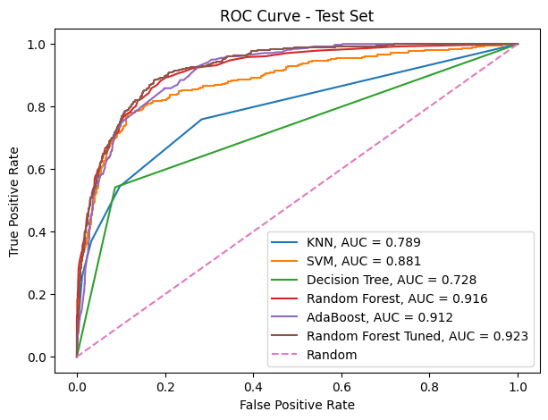
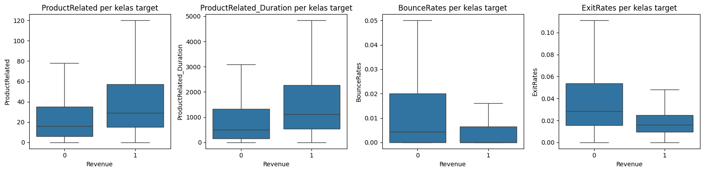
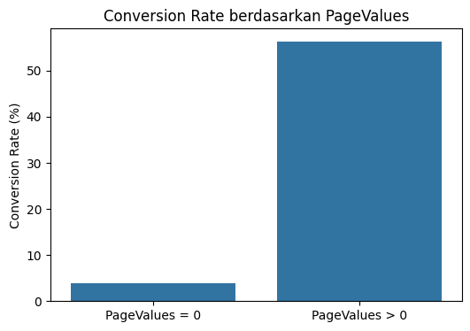
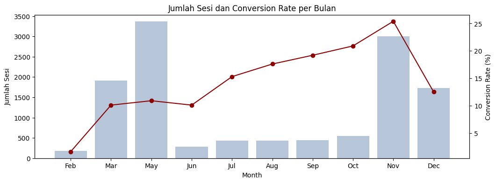
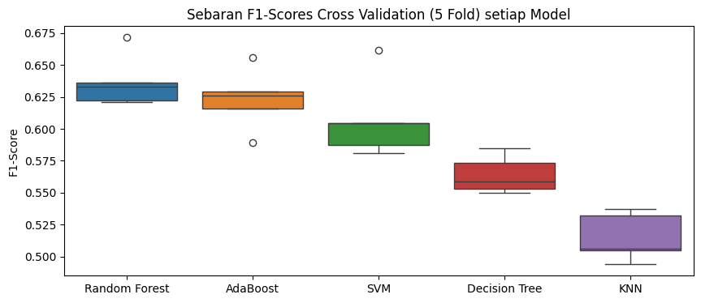
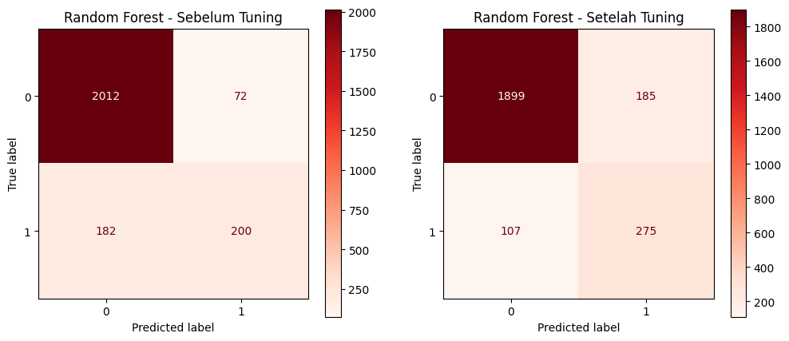

# 🛒 Prediksi Potensi Pembelian Sesi Kunjungan Toko Online

**Klasifikasi sesi pengunjung e-commerce untuk promo yang lebih tepat sasaran (Random Forest + Streamlit)**

**Aplikasi:** https://prediksi-pembelian-online.streamlit.app

> **English summary.** A binary classifier that predicts whether an online-store session ends in a purchase, using Google Analytics–style navigation features (UCI Online Shoppers Purchasing Intention, 12,330 sessions, 15.5% buyers). Five models were compared with 5-fold cross validation on F1; the tuned Random Forest reaches **ROC-AUC 0.923, recall 0.720, precision 0.598** on the test set, which makes promo targeting about **3.9× more precise than random**. The full preprocessing pipeline is saved as one file and served in a two-page Streamlit app (EDA + Prediction).

Project Milestone 2, program Data Science Hacktiv8 (Oktober 2026).



---

## 1. Latar Belakang

Sebagian besar pengunjung toko online tidak jadi membeli. Pada dataset ini, **84,5% sesi kunjungan berakhir tanpa pembelian**. Kalau promo atau voucher diberikan ke semua pengunjung secara merata, banyak anggaran yang terbuang. Masalah ini makin penting karena industri e-commerce di Indonesia sudah meninggalkan strategi "bakar uang" dan dituntut lebih efisien.

Project ini memprediksi apakah sebuah sesi berakhir dengan pembelian berdasarkan perilaku navigasi pengunjung. Hasilnya dipakai untuk menentukan sesi mana yang layak diprioritaskan untuk diberi promo.

**Pengguna:** tim marketing/CRM toko online yang mencatat aktivitas pengunjung dengan Google Analytics.

## 2. Data

- **Sumber:** [Online Shoppers Purchasing Intention Dataset — UCI](https://archive.ics.uci.edu/dataset/468)
- **Ukuran:** 12.330 sesi × 18 kolom (10 numerik, 7 kategorikal, 1 target `Revenue`).
- **Karakteristik:**
  - Tidak ada missing value.
  - 125 baris duplikat (sesi *bounce*) tetap dipertahankan, karena setiap baris adalah sesi pengguna yang berbeda.
  - Target **imbalanced**: hanya 15,5% sesi yang membeli. Karena itu metrik utama adalah F1-score, bukan accuracy.
  - Data bulan Januari dan April tidak tersedia.

## 3. Temuan EDA

**1. Pembeli bernavigasi lebih dalam.** Mereka membuka ±2x lebih banyak halaman produk, menghabiskan ±2,2x lebih lama di halaman produk, dan exit rate-nya lebih rendah.



**2. `PageValues` adalah sinyal terkuat.** Conversion **56,3%** saat sesi mengunjungi halaman bernilai, dibanding hanya **3,9%** saat tidak.



**3. Waktu kunjungan berpengaruh.** November punya conversion tertinggi (25,4%). Mei punya kunjungan terbanyak, tetapi conversion-nya hanya 10,9%.



## 4. Metode

**Feature engineering.** Semua perhitungan hanya memakai train-set untuk mencegah *data leakage*.

| Tahap | Yang dilakukan |
|---|---|
| Split | Train-test split dengan `stratify=y`, supaya proporsi pembeli ±15,5% di kedua set |
| Cardinality | Kategori `OperatingSystems` dan `TrafficType` yang muncul < 100 kali digabung menjadi `Other`. Daftarnya disimpan untuk inference |
| Outlier | `Winsorizer` (IQR, fold=3) untuk fitur skewed. `PageValues`, `Informational`, `Informational_Duration`, dan `SpecialDay` **tidak** di-capping karena IQR = 0; capping akan mengubah semua nilai > 0 menjadi 0 |
| Feature selection | Spearman (numerik), Chi-Square (kategorikal), dan cek multikolinearitas. Drop `Region` (p = 0,68), `Browser` (p = 0,057), dan `BounceRates` (korelasi 0,91 dengan `ExitRates`) |
| Scaling & encoding | `ColumnTransformer`: `StandardScaler` untuk numerik, `OneHotEncoder(handle_unknown='ignore')` untuk kategorikal |

**Modeling.**
- 5 algoritma dibandingkan dengan **cross validation 5-fold** (F1): KNN, SVM, Decision Tree, Random Forest, AdaBoost.
- Random Forest terpilih karena F1 CV tertinggi (0,637) dan stabil antar fold (std 0,018).
- Random Forest lalu di-tuning dengan `RandomizedSearchCV`: 30 kombinasi dari 1.152, cv=5, scoring F1.
  - Parameter terbaik: `n_estimators=100`, `max_depth=15`, `min_samples_split=10`, `max_features='sqrt'`, `class_weight='balanced'`.



Seluruh langkah (Winsorizer → preprocessing → model) disimpan dalam **satu Pipeline**, sehingga aplikasi memakai proses yang persis sama dengan saat training.

## 5. Hasil

| Model (test set) | CV F1 | F1 | Recall | Precision | ROC-AUC |
|---|---|---|---|---|---|
| Random Forest (default) | 0,637 | 0,612 | 0,524 | 0,735 | 0,916 |
| **Random Forest (tuned)** | **0,686** | **0,653** | **0,720** | 0,598 | **0,923** |



**Cara membaca hasil:**
- **Trade-off recall vs precision.** Tuning dengan `class_weight='balanced'` membuat model menangkap 275 dari 382 pembeli; sebelumnya hanya 200. Gantinya, sesi yang salah diprediksi membeli naik dari 72 menjadi 185. Untuk kasus promo ini trade-off tersebut masuk akal: melewatkan calon pembeli biasanya lebih mahal daripada memberi satu voucher yang tidak terpakai.
- **Dampak bisnis.** Dari setiap 100 sesi yang diprediksi membeli, ±60 benar-benar membeli (precision 0,598). Base rate-nya hanya 15,5%, jadi promo **±3,9x lebih tepat sasaran** dibanding promo acak (0,598 ÷ 0,155).
- **Overfit berkurang** (F1 train 1,000 → 0,821), tetapi gap dengan test (0,653) masih ada.

## 6. Aplikasi Streamlit

Aplikasi punya dua halaman:
- **EDA:** ringkasan data, perilaku navigasi (fitur bisa dipilih), PageValues, tren bulanan, conversion per kategori, dan scatter interaktif (Plotly).
- **Prediction:** form satu sesi kunjungan. Outputnya probabilitas membeli dan rekomendasi tindakan: tidak perlu promo, promo ringan (probabilitas ≥ 30%), atau bukan prioritas.

## 7. Keterbatasan

- **Ketergantungan pada `PageValues`.** Fitur ini paling kuat, tetapi nilainya di Google Analytics dihitung dari transaksi yang terjadi setelah halaman tersebut dikunjungi. Di dunia nyata, nilainya baru terisi penuh saat pengunjung sudah dekat dengan transaksi, sehingga ada risiko *leakage*: performa saat dipakai di tengah sesi bisa lebih rendah daripada angka di atas. Langkah lanjutan yang ingin saya uji adalah melatih ulang model **tanpa** `PageValues` untuk melihat seberapa besar performanya turun.
- **Threshold masih default 0,5.** Threshold belum disesuaikan dengan biaya promo dan nilai pembelian. Untuk produksi, threshold sebaiknya dipilih berdasarkan budget.
- **Data terbatas.** Januari dan April tidak ada, dan datasetnya hanya mencakup satu periode, sehingga pola musiman belum bisa divalidasi lintas tahun.
- **Masih sedikit overfit** (F1 train 0,821 vs test 0,653).

## 8. Struktur Repository

```
├── src/
│   ├── streamlit_app.py           # entry point aplikasi (navigasi halaman)
│   ├── eda.py                     # halaman EDA
│   ├── prediction.py              # halaman Prediction
│   ├── model_rf_tuned.pkl         # Pipeline lengkap (Winsorizer + preprocessing + Random Forest)
│   ├── list_top_categories.txt    # daftar kategori hasil handling cardinality
│   └── online_shoppers_intention.csv
├── notebooks/
│   ├── P1M2_Baihaqsani.ipynb      # EDA, feature engineering, training, evaluasi, model saving
│   └── P1M2_Baihaqsani_inf.ipynb  # inference pada data baru
├── images/                        # grafik untuk README
├── requirements.txt
└── Dockerfile
```

## 9. Cara Menjalankan

**Lokal** (sudah diuji dengan Python 3.11):
```bash
pip install -r requirements.txt
streamlit run src/streamlit_app.py
```

**Docker:**
```bash
docker build -t prediksi-pembelian .
docker run -p 8501:8501 prediksi-pembelian
```

Untuk notebook, jalankan dari folder `notebooks/`. Path data dan model sudah mengarah ke `../src/`.

## 10. Tech Stack

- **Bahasa:** Python
- **Library:** pandas, numpy, scipy, scikit-learn, feature-engine, matplotlib, seaborn, plotly
- **Deployment:** Streamlit Community Cloud, Docker
- **Tools:** VS Code, Jupyter Notebook, Git & GitHub

## 11. Referensi

- Dataset: [UCI — Online Shoppers Purchasing Intention Dataset](https://archive.ics.uci.edu/dataset/468)
- [Katadata — Transaksi Belanja Online Hanya Naik 2%, Era Bakar Uang Berakhir](https://katadata.co.id/digital/teknologi/69e0aea6238dc/transaksi-belanja-online-hanya-naik-2-era-bakar-uang-berakhir)
- [Bisnis.com — Era Bakar Uang Berakhir, Badai PHK Menerpa Industri E-Commerce](https://teknologi.bisnis.com/read/20260707/266/1985959/era-bakar-uang-berakhir-badai-phk-menerpa-industri-e-commerce)

---

Dibuat oleh **Baihaqsani** · [GitHub @baihaqsani24](https://github.com/baihaqsani24)
